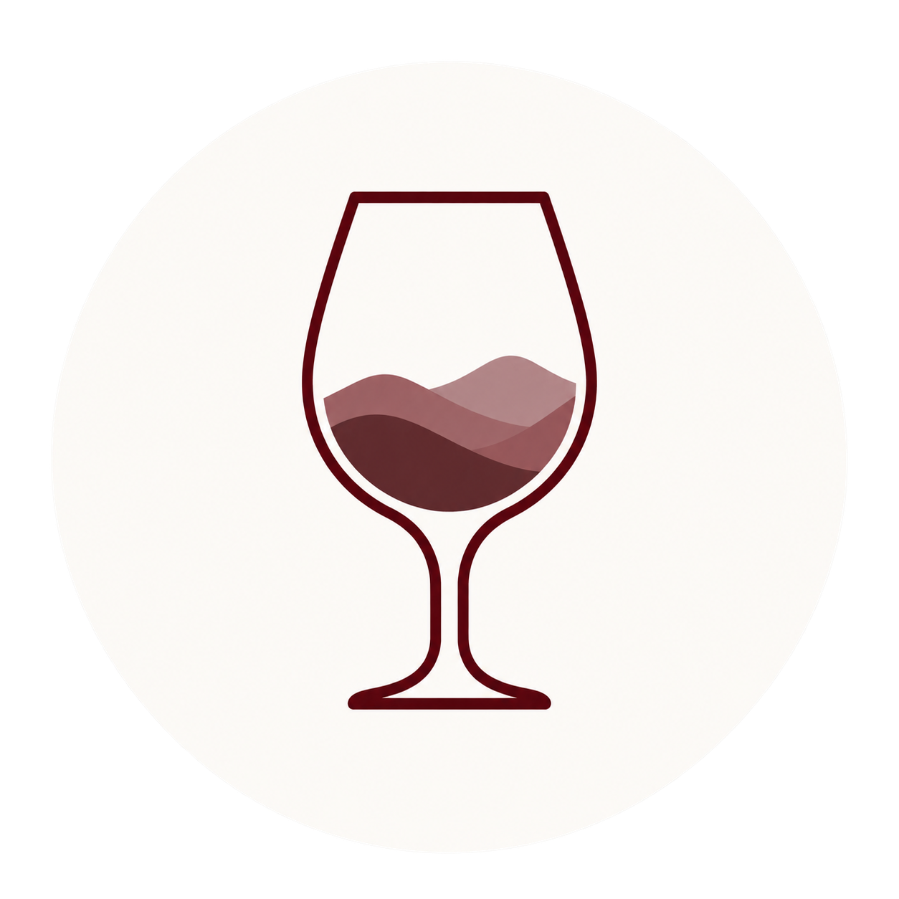
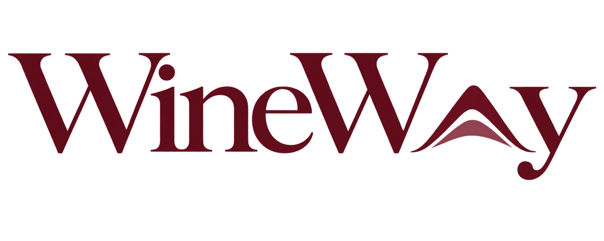

# WineWay - App móvil de turismo

> De bodega en bodega, coleccionando recuerdos.

Aplicación móvil de turismo bodeguero para personas que viajan a Mendoza. Acompaña al usuario antes, durante y después del viaje: ayuda a descubrir bodegas, armar itinerarios de visita y guardar un registro personal de los vinos que probó.

## El problema

Organizar una recorrida por bodegas hoy implica cruzar información dispersa entre webs, redes y recomendaciones sueltas, sin una forma simple de planificar días, presupuesto y traslados, ni de recordar después qué vinos probaste y qué te parecieron.

## Público objetivo

Personas que viajan a Mendoza y quieren organizar visitas a bodegas según su tiempo, presupuesto, ubicación e intereses — y también quienes solo quieren explorar la oferta bodeguera y guardar un recuerdo personal de los vinos que probaron.

## Estado del proyecto

En desarrollo. La app consume una API con Express y Prisma; el catálogo y los datos de cada usuario se guardan en SQLite.

## Stack técnico

- **React Native** + **Expo**
- **Expo Router** (navegación basada en archivos)
- **Context API de React** (gestión de estado: sesión, ruta en construcción, Mi Cava)
- Componentes de UI propios en `src/components/ui`
- **Express** + **Prisma** + **SQLite** (API y persistencia)

## Alcance del MVP

WineWay permite **planificar** una visita, no reservarla dentro de la app:

- Registro, login y exploración como invitado.
- Exploración de bodegas en lista y mapa, con búsqueda y filtros.
- Detalle de bodega: info, experiencias, vinos destacados, rating y reseñas.
- Armado de rutas (automático o manual), edición y guardado.
- Exportar el itinerario como archivo de calendario `.ics` (visita planificada, no reserva).
- Escaneo de etiquetas con la cámara e identificación del vino.
- **Mi Cava**: colección personal de vinos con rating y nota privados.
- Perfil de usuario y favoritos.

**Fuera del MVP:** reservas y confirmaciones dentro de la app, pagos/checkout, cancelaciones y disponibilidad en tiempo real. Para reservar, la app deriva al sitio externo de la bodega.

📄 Documentación funcional completa en [`/wiki`](./wiki):

| Documento                                                                      | Contenido                                              |
| ------------------------------------------------------------------------------ | ------------------------------------------------------ |
| [01 · Idea y alcance](./wiki/01-idea-y-alcance.md)                             | Problema, propuesta de valor, alcance del MVP          |
| [02 · Funcionalidades](./wiki/02-funcionalidades-mvp.md)                       | Detalle funcional de cada módulo                       |
| [03 · Pantallas y diseño](./wiki/03-pantallas-y-diseno.md)                     | Inventario de pantallas, userflows, branding           |
| [04 · APIs e integraciones](./wiki/04-apis-e-integraciones.md)                 | Google Maps/Routes/Places/Calendar, Gemini, cámara     |
| [05 · Dudas pendientes](./wiki/05-dudas-pendientes.md)                         | Decisiones de producto todavía abiertas                |
| [06 · Branding](./wiki/06-branding.md)                                         | Nombre, eslogan, paleta, tipografía e identidad visual |
| [07 · Sensores, cámara y ubicación](./wiki/07-sensores-camara-y-ubicacion.md)  | Implementación de cámara, ubicación y mapa             |
| [08 · Pendientes de implementación](./wiki/08-pendientes-de-implementacion.md) | Trabajo que falta después de la base y la API          |
| [09 · Generación de rutas](./wiki/09-generacion-de-rutas.md)                   | Especificación histórica del generador (backtracking)  |
| [10 · Selección voraz de rutas](https://github.com/valencalzetta/WineWay-backend/blob/main/wiki/10-seleccion-voraz-de-rutas.md)         | Especificación vigente del generador de rutas          |

## Componentes nativos

| Componente                   | Uso en WineWay                                            | Estado                            |
| ---------------------------- | --------------------------------------------------------- | --------------------------------- |
| 📷 **Cámara**                | Fotografiar la etiqueta de un vino para identificarlo.    | ✅ Implementado (`expo-camera`)   |
| 📍 **GPS / Geolocalización** | Centrar el mapa en el usuario y mostrar bodegas cercanas. | ✅ Implementado (`expo-location`) |

## Branding

| Color       | HEX       | Uso                                        |
| ----------- | --------- | ------------------------------------------ |
| Malbec      | `#722F37` | CTA principal, branding                    |
| Wine Dark   | `#321E20` | Títulos, headers                           |
| Crema       | `#F7F2EA` | Fondo principal                            |
| Verde Oliva | `#6F7255` | Estados secundarios, referencias a viñedos |
| Terracota   | `#C4775A` | Acentos y detalles                         |
| Carbón      | `#252525` | Texto principal                            |

Tipografía: **Inter**, en cuatro pesos (Regular, Medium, SemiBold, Bold). La identidad definida incluye isotipo, logotipo y el eslogan **“De bodega en bodega, coleccionando recuerdos.”** Ver [`wiki/06-branding.md`](./wiki/06-branding.md) para el detalle completo.

## Identidad visual

<p align="center">
  
  
</p>

- **Isotipo:** copa de vino con montañas, usado como icono de la aplicación, favicon y splash.
- **Logotipo:** firma tipográfica WineWay con montañas, usado en las pantallas de acceso.
- **Eslogan:** _De bodega en bodega, coleccionando recuerdos._

## Cómo correr el proyecto

Requiere Node.js 22.12 o superior de la rama 22, npm y Expo Go en el teléfono. El backend se instala por separado desde [WineWay-backend](https://github.com/valencalzetta/WineWay-backend).

Primero, en una terminal, cloná e iniciá el backend (una sola vez para instalar e inicializar):

```bash
git clone git@github.com:valencalzetta/WineWay-backend.git
cd WineWay-backend
npm ci
cp .env.example .env
npm run db:init
npm run dev
```

SQLite se crea con las migraciones y el catálogo de demostración. No hace falta instalar un servidor de base de datos. En los próximos arranques del backend basta con `npm run dev`.

Desde la raíz de este repositorio, instalá el frontend:

```bash
npm ci
cp .env.example .env.local
```

Los comandos `cp` son para Linux/macOS; en Windows se pueden copiar los archivos manualmente. No reemplaces archivos de entorno si ya los tenés configurados.

En `.env.local`, configurá `EXPO_PUBLIC_API_URL`:

- **Teléfono:** `http://IP_DE_TU_COMPUTADORA:3001/api`. Ambos dispositivos deben estar en la misma red Wi-Fi. `localhost` en el teléfono apunta al propio teléfono.
- **Web en la computadora:** `http://localhost:3001/api`.

En otra terminal, desde la raíz, iniciá Expo:

```bash
npm start
```

Escaneá el QR con Expo Go o presioná `w` para abrir la versión web en `http://localhost:8081`. Mantené ambas terminales abiertas. Si cambiás la URL de la API, reiniciá Expo.

Podés explorar sin iniciar sesión; para guardar datos, creá una cuenta desde Registro. No hay usuarios precargados. Para probar el escáner, abrí `docs/codigos-de-prueba.html` del repo del backend en la computadora y apuntá con el teléfono.

Más detalles de la API y la base en [README del backend](https://github.com/valencalzetta/WineWay-backend#readme).

## Exportar una ruta al calendario

En el detalle de cada ruta, **Agendar en Calendario** genera un archivo `.ics` con un evento por
visita (bodega, experiencia, inicio y duración), lo envía a la API y abre su enlace en el navegador.
Usa `expo-linking`, incluido en Expo Go: no requiere Apple Developer ni una development build.

El backend debe estar encendido y su dirección `EXPO_PUBLIC_API_URL` debe ser accesible desde el
teléfono. El enlace permite leer esta copia durante diez minutos, sin enviar el token de sesión al
navegador. Se guarda sólo en memoria; al reiniciar el servidor también vence. No es una suscripción.
La pantalla que aparezca (importación, vista previa o descarga) depende de iOS y del navegador:
hay que probarla en el dispositivo; no se garantiza el botón «Agregar todo».
Es una copia del itinerario: los cambios posteriores en WineWay no se sincronizan. Al volver a
importar, revisá los eventos anteriores para evitar duplicados según la app de calendario.

Referencias: [Expo Linking](https://docs.expo.dev/versions/v58.0.0/sdk/linking/),
[calendarios en iPhone](https://support.apple.com/en-ph/guide/iphone/-iph3d1110d4/ios).

Verificación del formato y los horarios: `node --test tests/calendario.test.mjs`.

## Enlaces del proyecto

- 🎨 Mockup / prototipo interactivo en Figma: (https://www.figma.com/proto/35T3xVmut0tRXGnD8jqEXx/WineWay?node-id=0-1&t=jKvqwIdq09QxSpdQ-1)
- 📦 Repositorio: [vitogiaquinta14/WineWay](https://github.com/vitogiaquinta14/WineWay)

## Autores

[@vitogiaquinta14](https://github.com/vitogiaquinta14)
[@valencalzetta](https://github.com/valencalzetta)
— Proyecto académico, PUCA (Facultad de Ingeniería y Ciencias Agrarias).

## Pruebas del frontend

`npm test` ejecuta las pruebas del cliente HTTP, formularios, identificación de vinos, incorporación a rutas, calendario y separación de mapas. Las pruebas de la API y de SQLite se ejecutan en el repositorio del backend.
